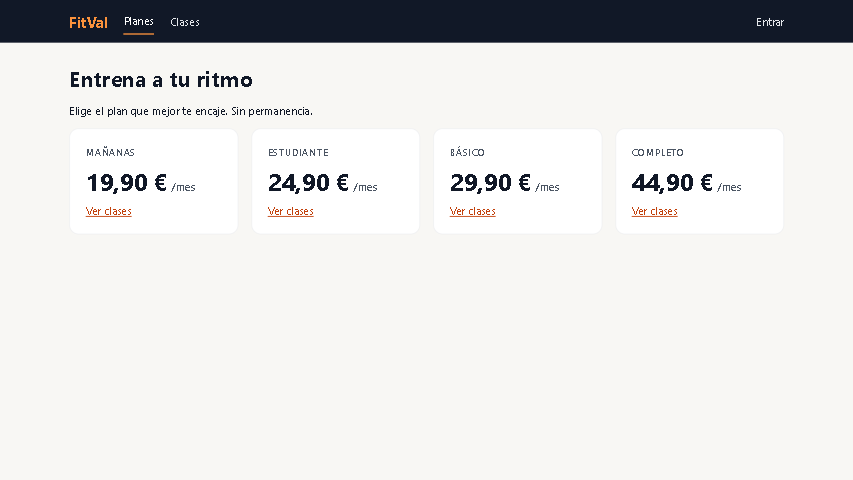
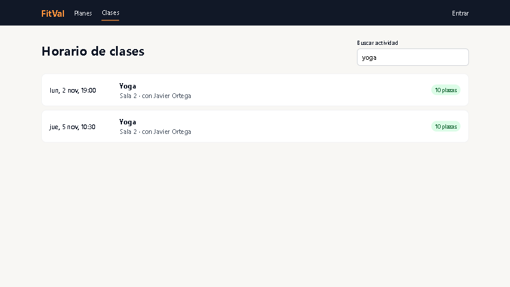
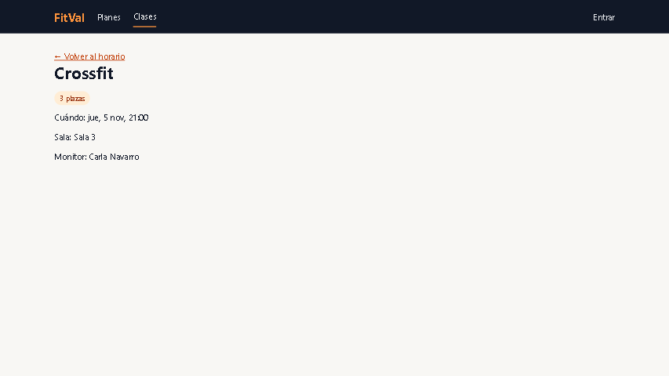
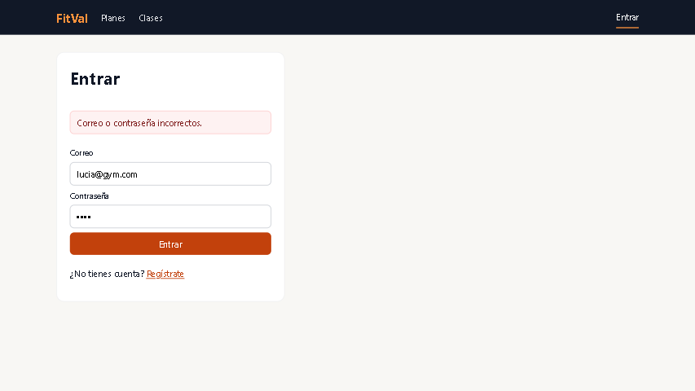
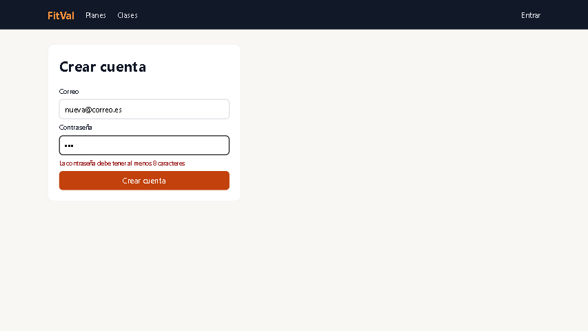
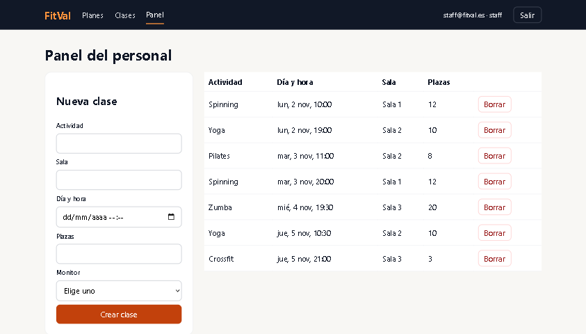

# FitVal

Web del gimnasio FitVal, hecha con React. Los socios ven los planes y el horario de clases, y el personal del gimnasio crea y borra clases.

Entrega React del bootcamp Full Stack Developer de The Bridge.

- **Web publicada (Netlify):** https://fitval-web-marcodemiguel.netlify.app
- **Versión con json-server (primera parte):** etiqueta [`v1-json-server`](https://github.com/Marcobros1/fitval-web/tree/v1-json-server)

## Tecnologías

- React 19 + TypeScript + Vite
- Redux Toolkit y RTK Query
- React Router
- React Hook Form + Zod
- CSS Modules
- json-server (API de prueba)
- Vitest + Testing Library

## Cómo arrancarla

Necesitas Node.js 24 o superior.

```bash
npm install
```

Crea el archivo `.env` a partir de `.env.example`:

```env
VITE_API_URL=http://localhost:3001
```

Arranca la API de prueba y la web, **cada una en su terminal**:

```bash
npm run api   # json-server en http://localhost:3001
npm run dev   # la web en http://localhost:5173
```

Si llenas `db.json` de pruebas, cópiale encima `db.initial.json` para volver a los datos de partida.

### Usuarios de prueba

| Correo | Contraseña | Rol |
|---|---|---|
| `staff@fitval.es` | `staff1234` | staff |
| `lucia@gym.com` | `lucia1234` | member (socia) |

## Scripts

| Comando | Qué hace |
|---|---|
| `npm run dev` | Arranca la web en modo desarrollo |
| `npm run api` | Arranca json-server con `db.json` en el puerto 3001 |
| `npm run build` | Comprueba los tipos y genera la web en `dist/` |
| `npm run lint` | Revisa el código con oxlint |
| `npm test` | Pasa los tests y se queda vigilando (`npx vitest run` los pasa una vez) |

## Páginas

| Ruta | Página | Quién entra |
|---|---|---|
| `/` | Planes | todos |
| `/classes` | Horario, con buscador | todos |
| `/classes/:id` | Detalle de una clase | todos |
| `/login` | Entrar | todos |
| `/register` | Crear cuenta | todos |
| `/staff` | Panel del personal | solo staff |

### Planes



### Horario buscando `yoga`



### Detalle de una clase



### Entrar



### Crear cuenta



### Panel del personal



## Tests

```bash
npx vitest run
```

10 tests en 5 ficheros: la sesión (`authSlice`), las plazas (`SpotsBadge`), los mensajes de error de la API (`getErrorMessage`), la tarjeta de plan (`PlanCard`) y la validación del registro (`RegisterPage`). El CI los pasa en cada PR.

## Respuestas

Las preguntas de la entrega están en [`respuestas.md`](respuestas.md).
